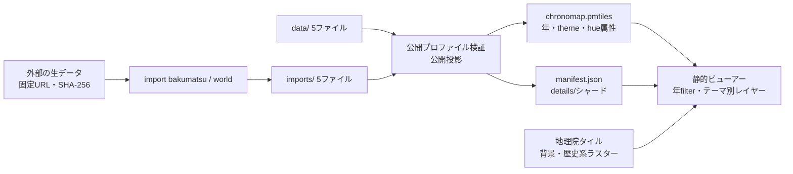

# Chronomap アーキテクチャ概要

作成日: 2026-09-14（2026-10-12 ADR 0008の実装に合わせて改訂）

Chronomapの目的は[プロダクト概要](../product/overview.md)、現行の構成判断は[ADR 0008](../adr/0008-seamless-national-map-with-temporal-vector-tiles.md)を参照する。そのほかの判断の根拠は[ADR 0001](../adr/0001-single-shared-web-application.md)、[ADR 0003](../adr/0003-maplibre-and-gsi-basemap.md)、[ADR 0004](../adr/0004-versioned-historical-features.md)、[ADR 0005](../adr/0005-normalized-data-package.md)、[ADR 0006](../adr/0006-possible-time-and-parallel-hypotheses.md)、[ADR 0007](../adr/0007-fail-closed-public-projection.md)に記録する。データの規範フィールドは[歴史データ規範モデル](../data/model.md)、配信物の契約は[全国統合タイルの公開契約](../data/tiles.md)を参照する。

## システム構成とデータフロー

Chronomapは静的Webアプリである。手作業のデータパッケージ（`data/`）と、固定した外部データから取込コマンドが生成するパッケージ（`imports/`）を、同じ5ファイル契約で検証・公開投影する。`build-tiles` は全パッケージの公開FeatureVersionを全国1つのPMTilesと、Datasetごとにシャード分割した詳細JSONへまとめる。ビューアーはPMTilesをHTTP Range要求で読み、年をMapLibreのフィルタで切り替え、地物を選ぶと詳細JSONを遅延読込する。

## コンポーネントの責務

- 取込コマンド（`src/chronomap_data/importers/`）: 生データをハッシュ検証つきで取得し、出典・権利・不確実性を付けた5ファイルパッケージへ変換する。
- 検証と公開投影（`schema_validation`、`semantic_validation`、`public_builder`）: 公開指定かつ権利・根拠が整合した到達可能レコードだけを投影する。
- タイル生成（`tile_builder`）: PMTiles、manifest、詳細シャードを決定的に生成し、原子的に置き換える。
- ビューアーのドメイン層（`web/src/domain/`）: manifest検証、URL状態、年フィルタ、非線形タイムライン、詳細シャードの解決。純粋関数としてテストする。
- 地図アダプター（`web/src/map/`）: MapLibre GL JSとPMTilesプロトコルへの依存をここに閉じ込める。
- UI（`web/src/ui/`）: レイヤーパネル、タイムライン、詳細パネル。

## 概念モデル

`Dataset`は権利・収録範囲・表示開始ズームを持つ配布単位であり、`HistoricalEntity`、`Source`、`Evidence`、`FeatureVersion`を5ファイルで収録する。`HistoricalEntity`は時代をまたいで追跡する歴史対象の同一性を表す。`FeatureVersion`は特定の可能な期間または仮説における`HistoricalEntity`の形状・属性・不確実性を表す。`Source`は史料・研究・地図などの根拠であり、`Evidence`を介してFeatureVersionの時間・位置・形状・同一性の主張に使う。並行仮説は同一Entityの重なる可能期間を持つFeatureVersion群として扱い、優先順位を付けない。ビューアーはDatasetを選ばせず、全Datasetの地物をテーマ別に重ねる。

## 品質と障害時の方針

生データのハッシュ不一致、公開投影の権利・参照・Evidence検証の失敗、tippecanoeの失敗では、公開物を生成又は置換しない。ビューアーはmanifestの読込に失敗したら理由と再読み込みを示し、詳細シャードの読込に失敗したら詳細パネルだけで知らせる。背景地図や歴史系ラスターの取得に失敗しても歴史地物と詳細は使える。

テストは、検証・公開投影・タイル契約・取込変換をPython側、URL状態・年フィルタ・タイムライン・シャード解決・スタイル生成をWebのユニットテスト、画面操作を390×844と1440×900のPlaywrightで確認する。出典・権利は詳細パネルとレイヤーパネルの収録データ一覧の両方で確認できる。キーボード操作、テキストでの状態説明を基本とし、凡例は色だけでなく点・線・面の記号でも区別する。

更新頻度、検索・集計、アクセス制御、複数利用者による編集が静的公開の範囲を超えたときはPostGIS/APIを検討する。
