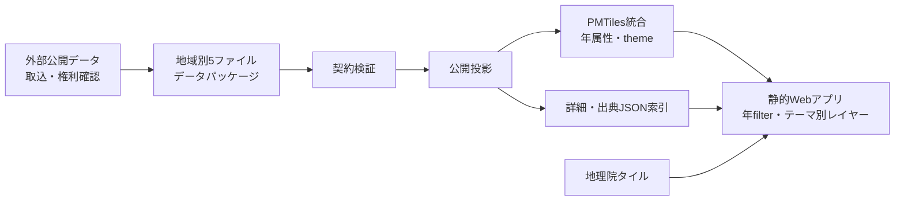
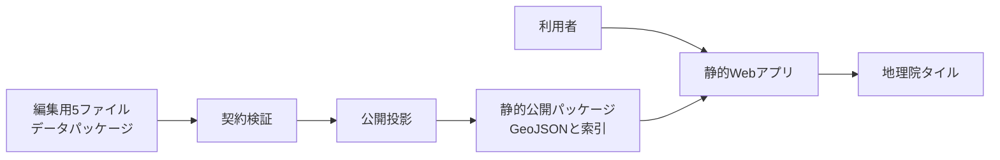

# Chronomap アーキテクチャ概要

作成日: 2026-09-14

Chronomapの目的とMVP範囲は[プロダクト概要](../product/overview.md)を参照する。判断の根拠は[ADR 0001](../adr/0001-single-shared-web-application.md)、[ADR 0002](../adr/0002-static-client-side-mvp.md)、[ADR 0003](../adr/0003-maplibre-and-gsi-basemap.md)、[ADR 0004](../adr/0004-versioned-historical-features.md)、[ADR 0005](../adr/0005-normalized-data-package.md)、[ADR 0006](../adr/0006-possible-time-and-parallel-hypotheses.md)、[ADR 0007](../adr/0007-fail-closed-public-projection.md)に記録する。データの規範フィールドと不変条件は[歴史データ規範モデル](../data/model.md)を参照する。

## システム構成とデータフロー

> 2026-10-11: [ADR 0008](../adr/0008-seamless-national-map-with-temporal-vector-tiles.md) により、配信はデータセット別GeoJSONから全国統合のPMTilesと詳細JSON索引へ、ビューアーは地域選択から全国シームレス地図へ移行する。以下の記述は移行完了まで現行実装の説明として残す。

移行前の構成:

MVPは静的Web SPAである。編集用の地域別データセットは5ファイルの正規化パッケージとして検証され、公開指定かつ権利・根拠が整合した到達可能レコードだけが決定的な公開パッケージに投影される。共通の表示エンジンはそのGeoJSONと索引をブラウザで読み込み、年代条件で絞り込み、MapLibre GL JSで地理院タイルの上に表示する。利用者の選択はMetadata Panelに渡され、出典、不確実性、ライセンス情報を確認できる。

## コンポーネントの責務

- UI/Application Shell: 画面構成、操作状態、アクセシブルな操作導線を提供する。
- Map Adapter: MapLibre GL JSへの地図・レイヤー・選択状態の反映を担う。
- Historical Data Loader: 地域別データセットを読み込み、形式と必須項目を検証する。
- Temporal Filter: 選択年代と`FeatureVersion`の有効期間を照合して表示対象を決める。
- Metadata Panel: 選択地物の説明、出典、不確実性、ライセンスを表示する。

## 概念モデル

`Dataset`は地域・権利・収録範囲を持つ配布単位であり、`HistoricalEntity`、`Source`、`Evidence`、`FeatureVersion`を5ファイルで収録する。`HistoricalEntity`は時代をまたいで追跡する歴史対象の同一性を表す。`FeatureVersion`は特定の可能な期間または仮説における`HistoricalEntity`の形状・属性・不確実性を表し、1つの`HistoricalEntity`は複数の`FeatureVersion`を持てる。`Source`は史料・研究・地図などの根拠であり、`Evidence`を介してFeatureVersionの時間・位置・形状・同一性の主張に再利用できる。並行仮説は同一Entityの重なる可能期間を持つFeatureVersion群として扱い、優先順位を付けない。

## 品質と障害時の方針

データ読込または検証に失敗してもアプリ全体を停止させない。失敗した地域データセットまたはレイヤーだけを非表示にし、利用者に対象、原因、再試行可否を明示する。公開投影の権利・参照・Evidence検証が失敗した場合は、公開物を生成又は置換しない。背景地図の失敗も同様に、歴史データの詳細確認を可能な範囲で保つ。

テストは、Temporal Filterとデータ検証をドメイン境界として重点化し、Map Adapterは地図ライブラリ境界として統合テストの対象にする。出典・ライセンスはMetadata Panelとデータセットの両方で確認可能にする。キーボード操作、十分なコントラスト、テキストでの状態説明を基本とし、地図の視覚情報だけに依存しない。

GeoJSONの配信量または描画量がMVPの性能目標を継続して満たせなくなったときはPMTilesを検討する。更新頻度、検索・集計、アクセス制御、複数利用者による編集が静的公開の範囲を超えたときはPostGIS/APIを検討する。いずれも現時点では導入しない。
