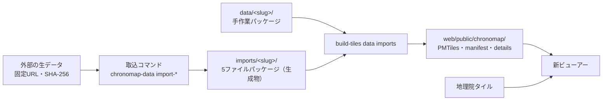

# ADR 0008 M2〜M6 設計書

作成日: 2026-10-12
対象: [ADR 0008](../../adr/0008-seamless-national-map-with-temporal-vector-tiles.md) のM2〜M6（[ロードマップ](../../product/roadmap.md)）
前提: M1（`build-tiles`、[全国統合タイルの公開契約](../../data/tiles.md)）は c89de10 で完了している。

## 目的

全国シームレス地図のビューアーを新規に作り、全国規模の外部データ（幕末期の村・郡・国・藩領、世界の国境の時系列、地理院の歴史系ラスター）を出典付きで取り込み、旧ビューアーを撤去する。完了時にWebUIの受け入れレビューができる状態にする。

## 全体構成



- 取り込んだデータは、既存の5ファイル契約（[ADR 0005](../../adr/0005-normalized-data-package.md)）に変換して `imports/<slug>/` に生成する。数十MBになるため `imports/` はGitに入れない。手作業のパッケージは従来どおり `data/` に置く。
- 生データは取込コマンドがURLから取得し、SHA-256が一致しなければ失敗する（fail-closed）。取得先とハッシュはコードの定数に固定する。

## タイル契約の拡張（M1契約の改訂）

`docs/data/tiles.md` を次のとおり改訂する。

1. **複数のパッケージルート**: `build-tiles <root>... --output <dir>`。全ルートの直下パッケージをslug順に処理し、ルートをまたいだslugの重複はエラー。
2. **ズーム範囲**: タイルは0〜12。Datasetは任意の `display.minZoom`（0〜12、既定4）と `display.maxZoom`（既定12）を持てる。地物はその範囲のタイルにだけ入る（tippecanoeの地物単位の `minzoom`・`maxzoom`）。世界の国境は0〜6、幕末の村の点は9〜12などとする。
3. **地物属性の追加**: `hue`（int、0〜11）。`entity_id` のFNV-1a 32bitハッシュを12で割った余り。国・勢力圏の塗り分けに使う。属性は8つになる。
4. **詳細索引の分割**: `details/<slug>/<shard>.json`。シャード数は `ceil(公開地物数 / 200)`（最低1）。地物は `fnv1a32(feature_version_id) % シャード数` のシャードに入る。`entities`・`evidence`・`sources` は、そのシャードの地物から到達できるものだけを入れる。manifestの各datasetは `details` の代わりに `detailShards`（int）を持つ。
5. **既定の年**: manifestに `defaultYear` を追加する。`years` のうち、その年に表示される地物数が最大の年（同数なら古い年）。`years` が空なら `null`。
6. **歴史地図ラスター**: Datasetの `historicalMapAssets` のうち `tileTemplate` を持つものを、manifestの `rasters` に並べる（`id`、`dataset`、`title`、`date`、`tileTemplate`、`attribution`、`bbox`、`minZoom`、`maxZoom`）。

`dataset.schema.json` に任意の `display: {minZoom}` を追加する。FeatureVersionのスキーマは変更しない。

## M3/M6 取込データ

### 幕末期近世村（`bakumatsu`）

- 出典: 本田謙一ほか「幕末期近世村領域データ」v2.01（GitHub `yaoyue00085856/Kyudaka_agrivillage`、CC BY-SA 4.0）の `01_Village_point_data_v2.csv`（CP932、66,581行）、`03_KEY_AID.csv`。面は農林水産省「農業集落境界データ（2015年）」都道府県別shapefile（出典明示・加工者明示で自由利用）と、上記の対応表から復元する。
- 生成するEntityとFeatureVersion（すべて慶応3年1月1日時点の領分に基づく幕末スナップショット）:
  - 村の点（`settlement`）: 全村。`display.minZoom` 9。
  - 郡の面（`boundary`）: 村の面を郡IDで融合。
  - 国の面（`polity`）: 村の面を国IDで融合。
  - 藩領の面（`sphere-of-influence`）: 村の面を `領分１` で融合。相給（複数領主）の村は主たる領分（`領分１`）だけで扱い、説明に明記する。
- 期間: 開始・終了とも慶応年間（`earliestYear` 1865、`latestYear` 1868、`precision: period`、`qualifier: circa`）。表示上は1865〜1868年に現れる。それ以前・以後の村・郡・国の形を推測で延長しない。
- 不確実性: 位置・形状は `approximate`（2015年の農業集落境界から推定した領域であり、幕末の村境そのものではない）。同一性は `well-supported`。
- 規模を抑えるため3パッケージに分ける: `bakumatsu-villages`（村の点）、`bakumatsu-provinces`（国・郡）、`bakumatsu-domains`（藩領）。

### 世界の国境（`world`）

- 出典: A. Ourednik "historical-basemaps"（GitHub `aourednik/historical-basemaps`、GPL-3.0）の `geojson/world_*.geojson`（53時点）。特定コミットに固定する。
- 1時点の各ポリゴンを1 FeatureVersionとし、Entityは `NAME` ごと（同名は同一Entity）。
- 期間: スナップショット年 `Y` から次のスナップショット年の前年までを `start: {Y, Y}`、`end: {Y, 次-1}` とする（次の時点までその境界が続いたとは主張せず、`temporal` を `approximate` にして説明に明記する）。最後の時点（2010年）は2010年で閉じる。`bcN` は `-N` 年とする。
- 不確実性: 位置・形状は `BORDERPRECISION` が3なら `well-supported`、それ以外は `approximate`。
- `display.minZoom` 0。日本・中国を含む全世界の国・勢力の範囲をM6の第1段とする（中国の正史の城邑データは後続）。

### 地理院の歴史系ラスター（`gsi-history`）

`historicalMapAssets` として登録し、manifestの `rasters` に出す。

| id | 名称 | 年代 | タイル |
| --- | --- | --- | --- |
| `swale` | 明治期の低湿地 | 1880年代〜1910年代 | `https://cyberjapandata.gsi.go.jp/xyz/swale/{z}/{x}/{y}.png` |
| `lcmfc2` | 治水地形分類図（旧河道・旧水部） | 更新版 | `https://cyberjapandata.gsi.go.jp/xyz/lcmfc2/{z}/{x}/{y}.png` |
| `ort_USA10` | 空中写真（1945〜1950年） | 1945〜1950年 | `https://cyberjapandata.gsi.go.jp/xyz/ort_USA10/{z}/{x}/{y}.png` |
| `ort_old10` | 空中写真（1961〜1969年） | 1961〜1969年 | `https://cyberjapandata.gsi.go.jp/xyz/ort_old10/{z}/{x}/{y}.png` |

地理院タイルの利用規約に従い、出典「国土地理院」を表示する（[ADR 0003](../../adr/0003-maplibre-and-gsi-basemap.md)）。ズーム範囲は配信を確認した値（低湿地・治水地形分類図は5〜16、空中写真は10〜17）とする。手作業パッケージ `data/gsi-history`（地物0件）の `historicalMapAssets` として持つ。

## M2/M4 新ビューアー

旧 `web/src`・旧テストをすべて削除し、次の構成で作り直す（M5を同時に完了する）。

```
web/src/
  main.ts              起動: manifest読込 → 地図 → UI
  domain/
    manifest.ts        manifestの型と検証
    view-state.ts      URLハッシュ ⇔ 表示状態（純粋関数）
    year-filter.ts     年フィルタ式（純粋関数）
    timeline.ts        非線形タイムライン（純粋関数）
    details.ts         シャード計算・詳細の取得とキャッシュ
    fnv1a.ts           ハッシュ（Python実装と同じ値）
  map/
    style.ts           MapLibreスタイル（背景・ラスター・テーマ別レイヤー）
    map-view.ts        MapLibre・PMTilesプロトコルの境界
  ui/
    layer-panel.ts     左パネル: テーマ別表示、ラスター、背景の濃さ、凡例
    timeline-bar.ts    下部: 年スライダー、目盛り、前後の収録年へ移動
    detail-panel.ts    地物の詳細・可能期間・不確実性・Evidence・出典・権利
    search-box.ts      地理院の住所検索APIで移動
  styles.css
```

### 画面

- 全画面の地図（背景は地理院の淡色地図。標準地図・写真に切替可、濃さ調整可）。
- 左上に折りたためるパネル: 検索、テーマ別レイヤー（10テーマ。色と記号の凡例付き）、歴史地図ラスター（4種、年代表示付き、不透明度）。
- 下部にタイムライン: 現在の年を大きく表示し、スライダーで年を選ぶ。収録年（manifestの `years`）を目盛りとして描き、前後の収録年へ移動するボタンを持つ。
- 地物をクリックすると右側（スマートフォンでは下部シート）に詳細を出す。同じ位置に複数の地物があれば一覧から選ぶ。
- 地図上のラベル: 国・藩領・村の名前（`name`）を、ズームに応じて表示。

### URL

`#<zoom>/<lat>/<lng>/<year>` を基本とし、非表示のテーマとラスターをクエリ風に付ける（例: `#6/36.2/138.25/1867?off=route,other&raster=swale`）。不正値は既定値に戻す。地図を動かす・年を変えるたびに `history.replaceState` で更新する。BCの年は負の整数（例: `-500`）。

### 年フィルタ

`["all", ["<=", ["get","from_year"], y], [">=", ["get","to_year"], y]]` をテーマ別レイヤーすべてに適用する。

### 非線形タイムライン（M4）

スライダー位置（0〜1）と年の対応を区分線形で定義する。区間と重み（相対的な幅）は次のとおりで、収録年の密度が高い日本の中近世を広く取る。

| 区間 | 重み |
| --- | --- |
| -123000 〜 -3000 | 0.5 |
| -3000 〜 500 | 1.5 |
| 500 〜 1450 | 1.5 |
| 1450 〜 1650 | 2.5 |
| 1650 〜 1870 | 2 |
| 1870 〜 2025 | 1.5 |

ただしmanifestの `yearRange` の外は使わない（範囲で切り詰めて再正規化する）。スライダーで選んだ年は整数に丸める。キーボードの←→は1年、PageUp/PageDownは前後の収録年へ移動する。

## M5 撤去

旧ビューアーのコード・テスト・E2E、`web/public/data/`、`web/src` の教材・カタログ・価格・フィードバック・印刷、関連する `qrcode` 依存を削除する。`build-public` コマンドは公開投影の検証用として残す（タイル生成が内部で使う）。2026-10-05以前のプロダクト文書の該当節は履歴として残す。

## テスト

- Python: 取込（小さなフィクスチャのCSV・shapefile・GeoJSONで、件数・期間・属性・権利・決定性）、タイル契約の拡張（複数ルート、minZoom、hue、シャード、defaultYear、rasters）。
- Web unit（vitest）: view-state、year-filter、timeline、fnv1a（Pythonと同じ値）、details のシャード計算、manifest検証。
- E2E（Playwright、390×844と1440×900）: 初期表示に地図・タイムライン・パネルがある、年を変えるとURLが変わり地物の表示が変わる、テーマの非表示、地物クリックで詳細と出典が出る、URL直アクセスで同じ状態に戻る、横はみ出しなし。E2Eはテスト用の小さなパッケージから生成したタイルで動かす。

## 受け入れ基準

1. `uv run pytest -q`、`npm test`、`npm run build`、`npm run test:browser` が通る。
2. `chronomap-data import-*` で取込パッケージを作り、`build-tiles data imports --output web/public/chronomap` が成功する。
3. `npm run dev` で開くと、全国が1枚の地図で、既定年（幕末）に村・郡・国・藩領が表示され、年を動かすと巨椋池・利根川などの既存データや世界の国境が切り替わる。
4. ADR 0008のコア受け入れ基準（[core-acceptance](../../product/core-acceptance.md) の2026-10-11の節）を満たす。
5. 旧ビューアーのコードが残っていない。資料に矛盾がない。
